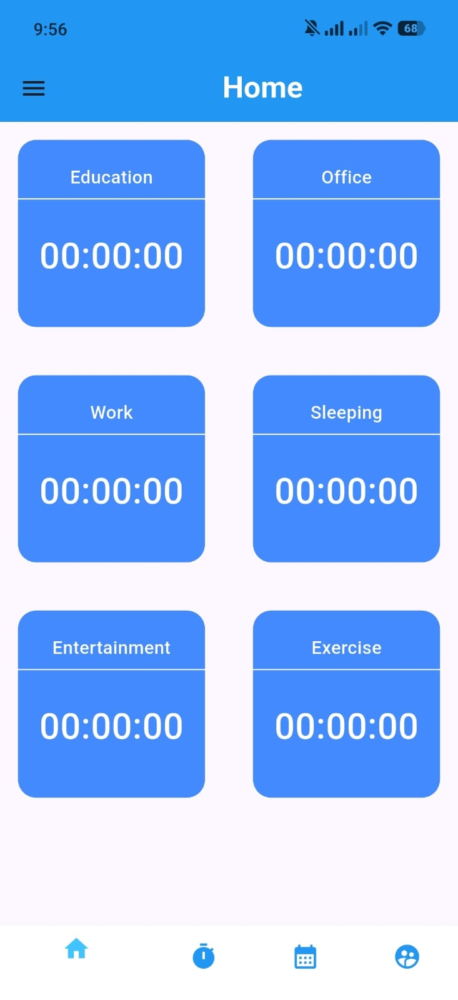
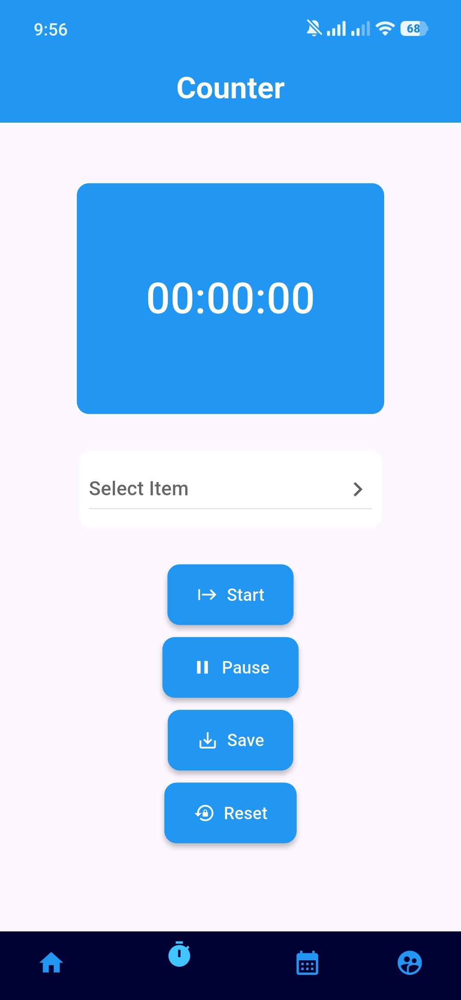
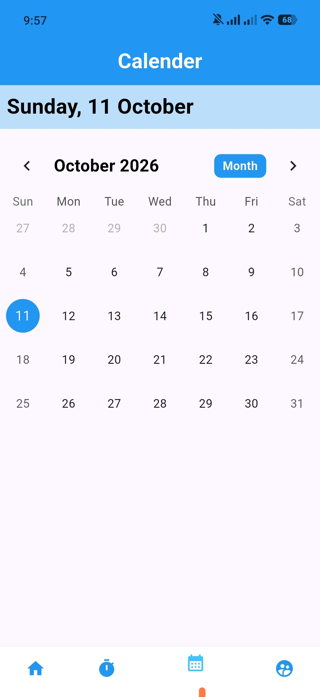
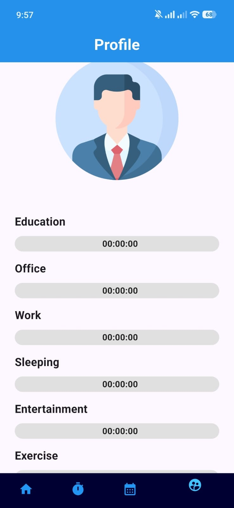

# Hourify ⏳

**Hourify** is a sleek and efficient time management & activity tracking application built with Flutter. It helps users log their daily routine, track time spent on various tasks (Education, Office, Work, Exercise, etc.), and analyze productivity with clean visual percentage progress bars.

---

## ✨ Features

- ⏱️ **Real-time Counter & Timer:** Select a category and track time spent accurately with Start, Pause, Save, and Reset controls.
- 📊 **Dynamic Activity Grid:** View all your active and saved time tracking categories in an intuitive grid interface on the Home Screen.
- 📈 **Productivity & Progress Reports:** Visualize percentage completion and total time spent per activity on the Profile Screen.
- 📁 **Centralized Categories:** Easily manage task categories from a single centralized controller.

---

## 📱 App Screenshots

Here are the app screen previews:

| Home & Counter | Profile & Stats |
| :---: | :---: |
|  |  |
|  |  |

### Additional Overview


---

## 🚀 Getting Started

This project is a starting point for a Flutter application.

### Prerequisites
- Flutter SDK installed on your machine.
- Android Studio / VS Code configured with Flutter plugins.

### Installation

1. **Clone the repository:**
   ```bash
   git clone [https://github.com/your-username/hourify.git](https://github.com/your-username/hourify.git)